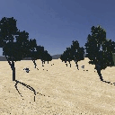

# AIGreenBots Project -- Deliverable 4.3
## Individual Research Project #07: Cognitive architecture for agricultural robots supporting anticipation.

   

#### This work was supported by the AIGreenBots project funded by the European Union’s Horizon Europe research and innovation programme under the Marie Skłodowska-Curie Actions Doctoral Networks (MSCA-DN), grant agreement ID: 101169330.

### **This repository currently under developing stage**

## Requirements
### Install RoboComp framework
#### You can install RoboComp using the script robocomp_install.sh.
```bash
wget https://raw.githubusercontent.com/robocomp/robocomp/development/robocomp_install.sh && bash robocomp_install.sh
```
#### For more detailed installation information we recommend to visit [RoboComp repository](https://github.com/robocomp/robocomp.git).


### Install the [Webots-bridge](https://github.com/robocomp/robocomp-robolab.git) component.
```bash
cd ~/robocomp/components
git clone https://github.com/robocomp/webots-bridge.git
cd webots-bridge
cmake .
make -j12
```

## Build the autonomous navigation component
```bash
cd ~/robocomp/components
git clone https://github.com/victorRomeroBaut/AIGreenBots_Deliverable_4.3.git
cd src/robocomp-predictiveNav/
cmake -B build && make -C build -j12
```

## Install python requirements
```bash
pip install -r requirements.txt
```
## Run the autonomous navigation component. 
#### Open webots world, then in one terminal initialize the webots-bridge component.
```bash
cd ~/robocomp/components/webots-bridge
bin/Webots2RoboComp etc/config
```
#### In a second terminal initialize the predictive navigation system.
```bash
cd AIGreenBots_Deliverable_4.3/src/robocomp-predictiveNav
bin/predictiveNav etc/config
```

## Citation

If you use this code or data in your research, please cite our paper:

> Romero-Bautista, V., & Broyer Paco Chipana, N. & Calderita Estévez, L. V. & Bustos García De Castro, P. & Pablo and Núñez Trujillo P. M. (2026). Toward Predictive Navigation for Agricultural Robots: A Review of Cognitive Architectures and a Deep Active Inference Proof of Concept. *2026 16th International Conference on Information Science and Technology (ICIST)*, 359-367. https://doi.org/10.1109/ICIST71072.2026.11727800

### BibTeX
```bibtex
@INPROCEEDINGS{Bautista2026TowardPredictiveNav,
  author={Romero-Bautista, Víctor and Broyer Paco Chipana, Nelson and Calderita Estévez, Luis Vicente and Bustos García De Castro, Pablo and Núñez Trujillo, Pedro Miguel},
  booktitle={2026 16th International Conference on Information Science and Technology (ICIST)}, 
  title={Toward Predictive Navigation for Agricultural Robots: A Review of Cognitive Architectures and a Deep Active Inference Proof of Concept}, 
  year={2026},
  volume={},
  number={},
  pages={359-367},
  keywords={Modeling;Architecture;Computer architecture;Printing;Robots;Navigation;Timing;Crops;Energy;Autonomous robots;Artificial intelligence;Cognitive architecture;Agriculture robotics},
  doi={10.1109/ICIST71072.2026.11727800}}